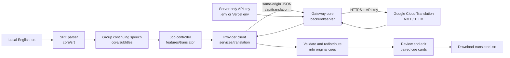
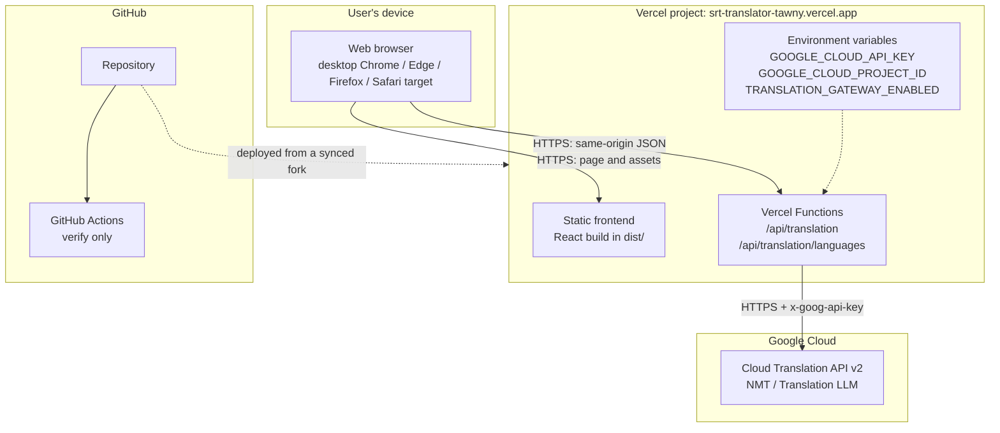

# Software Architecture

Updated: 2026-10-16 — restructured into the course's architecture-document format. Current decisions: [ADR-001](decisions/ADR-001-TELEMETRY-ONLY.md), [ADR-004](decisions/ADR-004-OWNER-FUNDED-CLOUD-TRANSLATION.md) and [ADR-006](decisions/ADR-006-JOINED-SPEECH-REDISTRIBUTION.md).

## 1. Project Overview

**Project Name:** SRT Translator

**Description:** A web app for movie viewers who have an English `.srt` subtitle file and want it in another language. The user chooses a file, a translation model (NMT or TLLM), a target language and a reading profile, then starts translation. The app joins speech that continues across cues, translates it through Google Cloud Translation, places the result back into the original cue time slots, lets the user review and edit each cue, and downloads a new `.srt` with the original numbering and timecodes.

**Live app:** [srt-translator-tawny.vercel.app](https://srt-translator-tawny.vercel.app)

**Architecture Style:** Client–server single-page web application. A React frontend does the subtitle work in the browser; a small server-side gateway (one shared core, two thin adapters) is the only part that talks to Google. There is no database. This is a modular monolith in one repository and one Vercel deployment, not separate microservices.

## 2. Technology Stack

| Component | Technology | Purpose |
| --- | --- | --- |
| Frontend | React 19.3 + TypeScript 5.9 | User interface and subtitle logic in the browser |
| Build tool | Vite 8.3 | Development server, `/api` proxy and production build into `dist/` |
| UI library | Ant Design 6.6 + `@ant-design/icons` | Layout, controls, feedback, shared light/dark theme |
| Long-list rendering | `@tanstack/react-virtual` | Mounts only visible subtitle cards for long files |
| Backend | Node.js (built-in `http`) locally; Vercel Functions in production | Translation gateway that holds the Google API key |
| Translation service | Google Cloud Translation API v2 — NMT and Translation LLM (TLLM) | Official machine translation, paid by the project owner |
| Database | None | Subtitles stay in browser memory; nothing is stored on a server |
| Authentication | None (no user accounts) | Visitors do not log in or supply keys; the server holds the owner's key |
| Testing | Vitest + Testing Library + jsdom; Playwright (Chromium) | Unit/integration tests and mocked browser workflows |
| Code quality | ESLint (typescript-eslint, React Hooks) + Prettier | Zero-warning lint and consistent formatting |
| Version control | Git + GitHub | Source code, issues and pull requests |
| CI | GitHub Actions | Format, typecheck, lint, tests, build, browser tests, build-artifact scan |
| Deployment | Vercel | Hosts the static frontend and the two `/api` Functions together |

## 3. System Architecture

The application has three main parts: the browser frontend, the server gateway, and the external Google translation service.



### Frontend (Presentation and Subtitle Logic Layer)

- Shows a compact header (logo/reset, theme switch, help, repository link), a settings sidebar and a subtitle preview, about 20% / 80% on desktop and stacked on mobile.
- Reads the chosen `.srt` file locally and strictly validates it (UTF-8, up to 5 MiB, balanced `<i>`, `<b>`, `<u>` only).
- Groups continuing speech, prepares translation batches and estimates characters, requests and list-price cost.
- Sends batches one at a time to the gateway, shows progress, elapsed time and attempts, and supports cancel and retry.
- Validates every response, places translated text back into the original cues, wraps lines and flags readability problems.
- Shows original and translated cues side by side, allows edits, and enables download only when every cue is complete and valid.

### Backend (Gateway Layer)

- Exposes two same-origin routes: language list and translation.
- Validates the model, target language, number of strings, request size and the TLLM character limit before calling Google.
- Adds the server-only API key and calls the official Cloud Translation v2 endpoint with `model` set to NMT or the TLLM model path.
- Converts Google failures into a small set of safe categories (for example `rate_limited`, `daily_quota`, `billing`) and never returns provider text, subtitles or the key.
- Fails closed in production unless `TRANSLATION_GATEWAY_ENABLED=true`.

### External Service (Translation Layer)

- Google Cloud Translation receives only the subtitle text strings needed for translation.
- It returns one translated string per submitted string. The app does not rely on Google preserving any invented cue markers.
- No database or file storage exists in this project.

### Code map — what each part does

| Folder / file | What the code does |
| --- | --- |
| `frontend/src/main.tsx`, `frontend/src/app/App.tsx` | Starts React; builds the Ant Design shell, sidebar controls, help modal, reset confirmation and active-job close warning. |
| `frontend/src/app/theme.ts`, `styles.css` | Shared Ant Design theme tokens (light/dark from the OS) and focused layout CSS. |
| `frontend/src/features/translator/useTranslator.ts` | Central React hook: file loading, language loading, settings, job state, editing and download. |
| `frontend/src/features/translator/job.ts` | Runs batches in order, redistributes each group's result, attributes failures to the affected cues. |
| `frontend/src/features/translator/CueRow.tsx`, `VirtualCueList.tsx` | Paired original/translated cards, edit controls, warnings, and the virtualized scrolling list with follow-current-cue. |
| `frontend/src/core/srt/` | `srt.ts` parses/serializes SRT and keeps exact indexes and times; `markup.ts` handles the safe `<i>/<b>/<u>` grammar. |
| `frontend/src/core/subtitles/` | `groups.ts` joins continuing speech and redistributes translations; `subtitles.ts` wraps lines and checks reading speed. |
| `frontend/src/services/translation/` | `provider.ts` interface, `googleTranslate.ts` gateway client with timeout/retry/validation, `batches.ts` batching and cost estimate. |
| `backend/server/translationGateway.mjs` | Shared gateway core: validation, Google request, safe error categories. |
| `backend/server/index.mjs` | Local Node HTTP server on `localhost:8787`, used behind Vite's dev proxy. |
| `backend/server/vercelAdapter.mjs` | Size-limited request reading and safe JSON responses for Vercel Functions. |
| `api/translation.mjs`, `api/translation/languages.mjs` | Thin Vercel Function entrypoints; Vercel requires them at the repository root. |
| `frontend/e2e/`, `*.test.ts(x)`, `*.test.mjs` | Mocked browser workflows and unit/integration tests; no test calls the paid API. |

The subtitle domain code (`core/`) does not import React or network code. Google-specific details stay behind the `TranslationProvider` interface. More detail: [frontend mechanism](frontend/MECHANISM.md) and [backend mechanism](backend/MECHANISM.md).

## 4. Main Features

### Load a Subtitle File

1. The user chooses or drops an `.srt` file.
2. The frontend checks the extension, the 5 MiB limit and UTF-8 encoding.
3. The parser reads every block and keeps the original index, start/end time strings and text.
4. Any invalid block stops the import with a visible error; no partial file is loaded.
5. The preview shows the cues in their continuation groups.

### Load Target Languages

1. When the page opens, the frontend calls `GET /api/translation/languages`.
2. The gateway asks Google for its NMT language catalogue.
3. The frontend validates the list and removes English (the fixed source language).
4. If loading fails or the list is unusable, an error with a Retry button is shown and Start stays disabled.

### Translate Subtitles

1. The user selects NMT or TLLM, a target language and an Adult (20 CPS) or Children (17 CPS) profile, then presses Start.
2. The frontend joins cues that continue a sentence (next cue starts with a lowercase letter, `...` or `…`). Speaker dashes, `[sound]` descriptions and `♪` music stay separate units.
3. Units are packed into bounded batches (at most 128 strings, about 5,000 characters, under 90,000 bytes) and sent one batch at a time to `POST /api/translation`.
4. The gateway validates the request, adds the API key and forwards it to Google.
5. The frontend checks the response count, text, markup, brackets and music symbols. A malformed response saves nothing from that batch.
6. Each joined translation is split back across its original cues using each cue's reading capacity and word boundaries, then wrapped to at most two lines of 42 characters where possible. This placement is approximate and marked for review.
7. Progress, elapsed time and attempt count update as batches complete.

### Handle Failures and Retry

1. If Google reports a per-minute quota limit, the gateway returns `rate_limited` with a retry delay (60 seconds by default).
2. The frontend shows a cancelable cooldown and retries the same batch, up to three attempts in total. Other temporary errors use short backoff.
3. Daily quota, billing, permission and invalid-request errors stop immediately.
4. Failures are shown under the affected cue cards; cues that were never attempted stay "waiting".
5. Retry translates only unfinished groups and never overwrites completed cues or saved edits.

### Review, Edit and Download

1. Original and translated cues appear side by side with index, timecode, status and readability warnings.
2. The user can edit a translated cue and save it; the edit is marked and kept.
3. Download is enabled only when every cue has valid output and no job is running.
4. The downloaded file keeps the original cue order, indexes and timecodes and is named `<original-name>.<language>.srt`.

## 5. Data Management

This project has **no database and no server-side storage**. All subtitle data lives in browser memory for the open tab.

**Cue** (parsed from the file, `frontend/src/core/srt/srt.ts`)
- `id` — internal ID such as `cue-1`
- `index` — the original cue number string
- `start`, `end` — the exact original time strings
- `startMs`, `endMs` — times in milliseconds for reading-speed checks
- `text` — the original subtitle text with supported markup

**Translation job state** (`frontend/src/features/translator/useTranslator.ts`)
- `translations` — translated text for each cue ID
- `edited` — which cues the user has edited
- `cueErrors` — the error shown under each failed cue
- `status` — `idle`, `running`, `completed`, `cancelled` or `failed`
- start/finish times, attempt count and retry cooldown time

Each source file has many cues; cues are grouped into continuation groups, and each group is split into speech units that are sent to the provider.

Reloading or closing the tab loses unfinished work; the app warns before closing during an active job. Browser-local checkpoint/resume is planned but **not implemented**. Telemetry (country/city, target language, movie identity) is a conditional future scope under ADR-001 and is **not implemented**; subtitle text and files must never be stored as telemetry.

## 6. API Design

| Method | Endpoint | Description |
| --- | --- | --- |
| GET | `/api/translation/languages?model=nmt\|tllm` | Returns Google's target-language list (the NMT catalogue for both models) |
| POST | `/api/translation` | Translates a batch of subtitle strings with the chosen model |

**Translation request body**

```json
{
  "q": ["joined speech unit 1", "unit 2"],
  "source": "en",
  "target": "mn",
  "format": "html",
  "model": "nmt"
}
```

- `model` is `nmt` or `tllm`; `q` holds 1–128 non-empty strings. TLLM requests are limited to 30,000 characters in total. Request bodies over 100,000 bytes are rejected with HTTP 413.
- A successful response returns Google's `data.translations` list unchanged; the frontend validates it before saving anything.
- Errors return `{ "error": { "message", "category", "retryAfterSeconds?" } }`. Categories include `invalid_request`, `gateway_disabled`, `rate_limited`, `daily_quota`, `quota`, `billing`, `key_restriction`, `api_not_enabled`, `access_denied`, `upstream_failure` and `gateway_failure`.
- On Vercel, other methods return HTTP 405; the local server returns 404 for unknown routes. Responses use `Cache-Control: no-store`.

## 7. Security Considerations

- The Google API key exists only on the server: in the ignored local `.env` or in Vercel environment variables. It is never sent to the browser, put in `VITE_*` variables, URLs, logs or downloaded files.
- The browser calls only same-origin `/api` routes, with credentials omitted.
- The gateway validates request shape and size before contacting Google; the Vercel adapter stops reading an oversized body while streaming.
- Gateway logs contain only the HTTP status and a safe error category, never subtitle text, provider messages or the key.
- Subtitle files are parsed strictly. Only `<i>`, `<b>`, `<u>` without attributes are allowed, and text is rendered as React text, never as trusted HTML.
- Provider responses are validated before they can become output.
- Production fails closed until `TRANSLATION_GATEWAY_ENABLED=true`. That switch is **not** a rate limit or spending cap; an owner-approved allowance, a Vercel Firewall rate limit and Google budget/quota controls are still required and not yet evidenced.
- There are no user accounts, so there is no application login to protect. This also means the public API has no per-user limit.

## 8. Deployment

- Frontend: Vercel static hosting (Vite builds `frontend/` into `dist/`)
- Backend: Vercel Functions `api/translation.mjs` and `api/translation/languages.mjs` (30-second maximum duration, same origin as the frontend)
- Translation service: Google Cloud Translation API (TLLM location `us-central1` by default)
- Database: none
- CI: GitHub Actions runs verification on pull requests and pushes to `main`; it does not deploy.



**Local development:** `npm run dev` starts Vite on `http://localhost:5173` and the Node gateway on `localhost:8787`. Vite proxies `/api` to the gateway; only the gateway reads `.env`. See [gateway setup](guides/GOOGLE_TRANSLATE_SETUP.md).

On 2026-10-08 the owner reported the deployed web flow working, and a read-only check of the language route returned 195 languages. Controlled paid NMT/TLLM smoke tests on the deployment and the production cost/abuse controls are still outstanding.

## 9. Architecture Decisions

We selected React + TypeScript + Vite because the app has rich client-side state (file, settings, job progress, edits) and typed domain logic, and the stack builds a static app that Vercel serves directly ([ADR-003](decisions/ADR-003-REACT-MIGRATION.md)).

We selected Ant Design because it supplies the standard layout, controls, feedback and theme tokens, so custom CSS is needed only for subtitle-specific layout ([UI component guide](guides/UI_COMPONENT_GUIDE.md)).

We selected a server-side gateway with an owner-funded key because visitors should not need a Google account or API key, and the key must never reach the browser ([ADR-004](decisions/ADR-004-OWNER-FUNDED-CLOUD-TRANSLATION.md)).

We selected Vercel Functions on the same origin because the frontend and the gateway deploy together, the browser needs no cross-origin requests, and the local server and Functions reuse one gateway core so their validation cannot drift apart.

We selected no database because the confirmed scope keeps subtitles and downloads local; cloud storage of subtitle files is deferred ([ADR-001](decisions/ADR-001-TELEMETRY-ONLY.md)).

We selected joined speech for both NMT and TLLM, followed by local approximate redistribution, because translating each cue alone loses sentence context, while Google's API does not guarantee invented cue markers survive ([ADR-006](decisions/ADR-006-JOINED-SPEECH-REDISTRIBUTION.md)).

We did not split the system into microservices because one solo-developed frontend with one small gateway shows no measured need for independent scaling or releases; extra services would add CORS, deployment and operations cost.

## 10. Future Improvements

These are **not implemented** and need owner decisions or evidence first:

- Browser-local checkpoint/resume after a page reload.
- Owner-approved public allowance, Vercel Firewall rate limit and Google budget/quota controls.
- A server-side upstream timeout for Google requests on the local gateway.
- Controlled live NMT/TLLM quality and timing review, and verified TLLM language coverage.
- Conditional telemetry statistics once location acquisition, retention and user notice are decided.

## 11. Architecture Changes

| Date | Change | Reason |
| --- | --- | --- |
| 2026-09-15 | Week 1 MVP: one standalone HTML file (archived in [docs/mvp/](mvp/srt-translator-beta-3.html)) using an undocumented Google consumer endpoint. | Vibe-coded starting point; kept as the "before" state. |
| 2026-09-17 | Ported to React/TypeScript/Vite/Ant Design with a provider interface and the official Cloud Translation API. | Separate UI, subtitle logic and provider; replace the unofficial endpoint ([ADR-003](decisions/ADR-003-REACT-MIGRATION.md)). |
| 2026-09-18 | Replaced visitor-entered browser keys with an owner-funded server gateway; dropped Gemini. | Keys must never reach the browser; visitors should not need accounts ([ADR-004](decisions/ADR-004-OWNER-FUNDED-CLOUD-TRANSLATION.md), superseding [ADR-002](decisions/ADR-002-USER-FUNDED-PROVIDERS.md)). |
| 2026-09-18 → 10-01 | Restored real joined-speech input for both models with local redistribution. | The React port grouped cues only on screen and sent each cue separately ([ADR-006](decisions/ADR-006-JOINED-SPEECH-REDISTRIBUTION.md), superseding [ADR-005](decisions/ADR-005-CONTEXT-AND-THROUGHPUT.md)). |
| 2026-10-08 | Added same-origin Vercel Functions; GitHub Actions changed from Pages deployment to verification only. | Vercel was confirmed as the host for both frontend and gateway. |
| 2026-10-08 | Separated code into `frontend/` and `backend/`, leaving only thin entrypoints in `api/`. | Clearer boundaries while keeping one deployment ([code audit](audits/CODE_AUDIT_2026-10-08.md)). |
